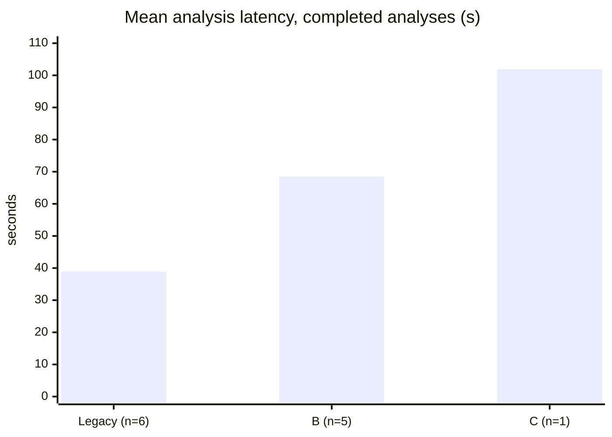
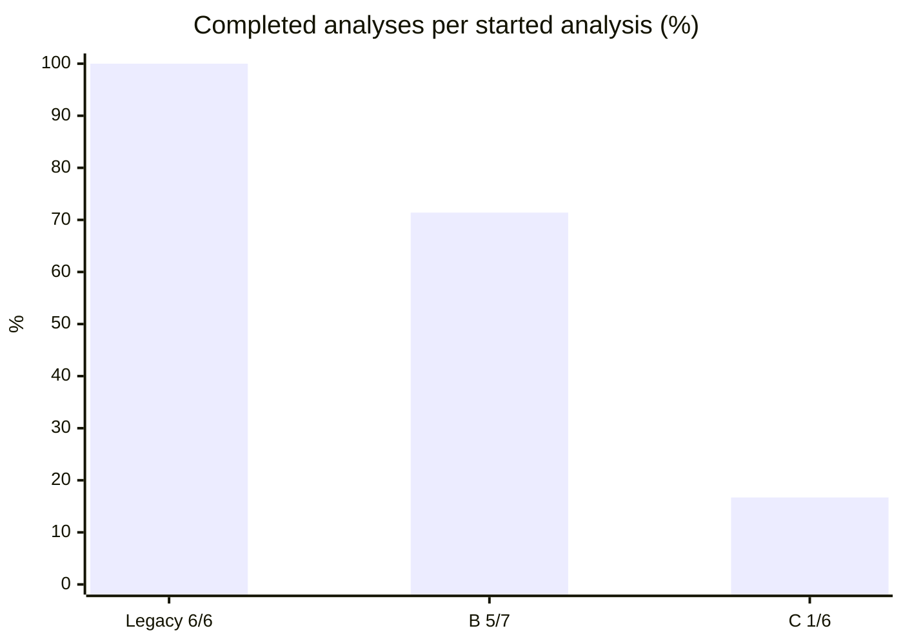
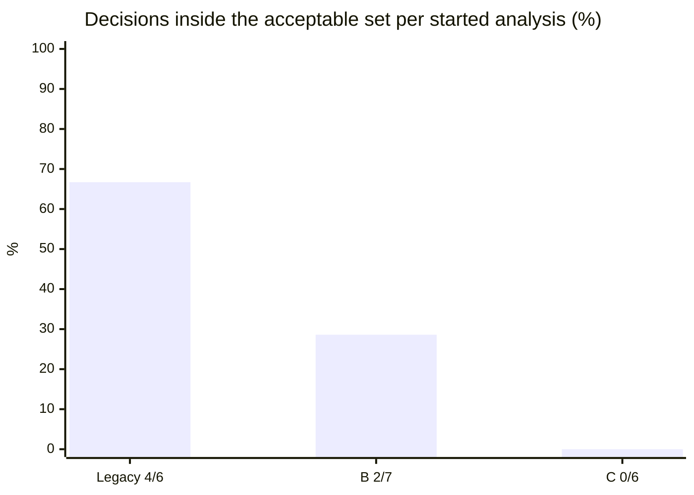
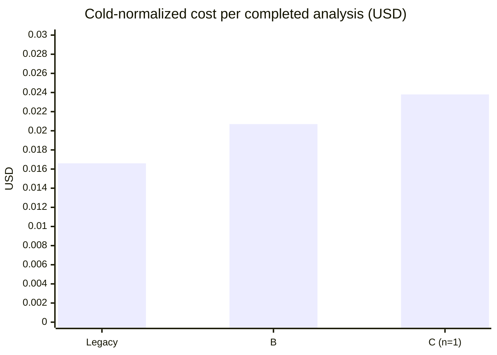

# T7 — Controlled Legacy / B / C pilot: evaluation report (ISSUE-718)

**Status:** final T7 record. **Owner outcome (2026-11-27): REVISE.** Neither B nor C meets the ADR-046 item 6 minimum bar, so no strategy is selected or promoted. Both experimental strategies are temporarily suspended pending remediation and a future owner-authorized evaluation. This is not the procedural rejected-arm freeze of ADR-046, because no winner was selected. Legacy remains the default pipeline. Gate A, T8 and later experimental phases stay blocked. The binding decision is the ADR-046 amendment of 2026-11-27 (T7 outcome) in `project-management/DECISIONS.md`.

**Scope of execution.** **The full 36-analysis pilot was not executed.** 19 analyses ran (24 provider calls). The owner approved the early termination after analysis #19, so the remaining 17 planned analyses are recorded as not started.

**Contents.** No CV text, no contact data, no full vacancy text: only metrics, short requirement anchors, evidence identifiers and ids. Raw data and the cleanup manifest are in the git-ignored folder `apps/api/storage/experimental-analysis-pilot/`.

---

## 1. Executive summary

- **Execution.**
  - 19 of the 36 planned analyses ran, with 24 of the 48 planned provider calls.
  - The runner stopped itself after #19 on its pre-set safety rule (3 consecutive failures). The owner then explicitly approved terminating the pilot at that point and stopping all further paid runs (2026-11-27).
  - Analyses #20–#36 (17) are **not started**. They are neither failures nor results.
- **Reliability is the dominant finding.**
  - **C:** of 6 started analyses, 1 completed, 4 were incomplete (X1 succeeded, X2's answer failed validation) and 1 failed at X1.
  - **B:** of 7 started analyses, 5 completed and 2 failed validation.
  - **Legacy:** 6 of 6 completed.
  - Every failure is a *contract-validation* failure of an answer the provider did return. None is an infrastructure failure.
- **Decision correctness**, inside the owner's acceptable set:

  | Arm | Correct / started analyses |
  |---|---|
  | Legacy | 4 / 6 |
  | B | 2 / 7 |
  | C | 0 / 6 |

  The model's own advisory decision was inside the acceptable set in **6 of the 6** completed experimental analyses. The deterministic policy turned 4 of them into skips outside the set: rule **H5** ("requires overstretch") decided 4 of the 6, and **S1** risk stacking decided one.
- **When an experimental analysis completes, extraction is at least as complete as legacy.** B completed-only completeness is 87/109 = 79.8 %, against legacy's 83/124 = 66.9 % (evaluator-judged). No completed run named an ineligible entry or lost a bar-relevant critical evidence item.
- **Minimum bar.**
  - B fails criterion 1 (Jobgether R02 failed) and criterion 3 (that failed run loses C-JG-1).
  - B satisfies criterion 4 only numerically, on the primary planned-run denominator (35.4 % against 33.7 %). Section 2 explains why this is not evidence of better extraction.
  - C fails criteria 1, 3 and 4.
  - Neither arm meets the bar. The selection rule is not reached and the owner outcome is **REVISE**.
- **Cost.**
  - Measured list-price cost of the 17 calls with recorded usage: **$0.1965**.
  - The 7 failed calls were billed by the provider but stored no usage (an implementation gap): likely **$0.128**, conservative upper bound **$0.183**.
  - Total expenditure estimate: **≈ $0.32, at most ≈ $0.38**. These are list-price estimates, not an invoice.
- **Root causes** (section 9).
  - Three repeated contract patterns explain all 7 failures:
    1. judgement `cited_ids` naming catalog evidence that is not in the coverage map (5 of 7);
    2. language risks citing language-requirement ids, which the risk contract does not accept (3 of 7);
    3. a non-enum language name in X1 (1 of 7).
  - Two implementation gaps blocked full root-cause analysis: failed stages store neither usage nor the raw answer.
- **Owner decision: REVISE** (2026-11-27).
  - The remediation roadmap R1–R4 in section 10 is proposed, not authorized. Each work package needs its own specification review and owner approval.
  - Any further paid evaluation needs a separate owner approval of execution and budget.

**Confirmed findings and hypotheses, kept apart.**
- **Confirmed** from stored data and code:
  - all 7 failures are contract-validation failures of returned answers;
  - the three validator rules and the code locations of section 9;
  - the experimental stages store neither usage nor the raw answer when validation fails;
  - H5 decided 4 of the 6 completed experimental analyses, with the recorded reasons;
  - the measured usage and costs;
  - the run conditions and the input equivalence.
- **Not available:** the original failed provider responses were **not retained** (only their hashes).
- **Not originals:** any fixture rebuilt later to reproduce a failure is a *reconstruction*, not an original provider response.
- **Estimated, not confirmed:**
  - the cost of the 7 unknown-usage calls is an estimate. It is not an independently confirmed or invoiced charge;
  - no figure in this report is an invoiced amount.
- **Hypotheses:**
  - contract complexity raises the failure rate;
  - C's X2 is more exposed to the language-id pattern;
  - the H5 wording causes the broad reading. Its effect is confirmed; the cause is inferred from the reasons.
- **Limited observations:**
  - Strategy C has **one** completed analysis, too few for any valid architecture selection;
  - the 6 of 6 correct advisory decisions are a promising but limited observation (6 analyses, 4 vacancies, mostly one repetition), not a measured property.
---

## 2. Evaluation method and frozen references

- **References and method:** `project-management/evaluation/experimental-analysis-pilot/references.md`.
  - Part B is the evaluation method; Part C is the frozen run conditions.
  - SHA-256 `3dfca38508772f49395a4a2e02e62a35719563cecce14e86bd5dbd0a4eaf1a54` (`references.sha256`).
  - Committed in **`bfce3cf`** at 2026-11-27 18:41:34 UTC, 10 minutes before the first paid call. The file was not changed afterwards.
- **Owner approvals on ISSUE-718.**
  - [Spec approval](https://github.com/strakhovdenya/jobflow-cv-pipeline/issues/718) (`spec-approved`, normalized body sha256 `52f7c2b0…b282`).
  - [Execution and budget authorization](https://github.com/strakhovdenya/jobflow-cv-pipeline/issues/718#issuecomment-7225757009), recorded before the first call: $1.50 operational budget, $1.20 pre-job pause threshold.
- **Evaluator-judged versus deterministic.**
  - *Deterministic:* decisions, scores, flags, tokens, latency, B/C quote spans, catalog-key hits, cross-run span overlap.
  - *Evaluator-judged:* every legacy requirement match (legacy has no quotes), legacy critical-evidence citations, and the semantic checks of B/C span pairs and case-level evidence hits.
  - Every judgement is recorded in `evaluation/adjudication.json`. The scripts are in `scripts/` (`evaluate.js`, `aggregate.js`).

**Owner adjudication of the early stop and of the completeness basis (2026-11-27).**
- **Early termination.** The owner approved ending the pilot after analysis #19. Analyses #20–#36 are *not started*: they are neither failures nor results, and nothing ran in their place.
- **Primary denominator.** The frozen Part B formula counts every planned run, so the **planned-run denominator stays the primary numerical measure**. Two more views are reported next to it:
  - **all planned analyses** (frozen formula; failed and not-started runs count 0): legacy 83/246 = **33.7 %**, B 87/246 = **35.4 %**, C 14/246 = 5.7 %;
  - **started analyses** (failures count 0, not-started excluded): legacy 83/124 = 66.9 %, B 87/153 = 56.9 %, C 14/124 = 11.3 %;
  - **completed analyses only:** legacy 83/124 = 66.9 %, B 87/109 = 79.8 %, C 14/15 = 93.3 % (n = 1).
- **Reading of criterion 4.**
  - Under the frozen planned-run formula, B meets the numerical condition "requirement completeness ≥ legacy" (35.4 % ≥ 33.7 %).
  - The early termination left the arms with **unequal exposure**: legacy 6 started runs, B 7, C 6, in different vacancies and repetitions. So this result is **not convincing evidence that B extracts better** than legacy.
  - It does not change the outcome, because B fails criteria 1 and 3.
---

## 3. Run conditions (measured)

| Condition | Value |
|---|---|
| Application commit | `ff05eebc87c537e18b569e87cae6b2fd581e48b2`, detached worktree `D:\projects_js\jobflow-t7-pilot` |
| Provider / model | `openai` / `gpt-6-luna` on all 24 `AiRun`s; `OPENAI_TIMEOUT_MS=600000`; `OPENAI_MAX_RETRIES=0`; output caps are the code defaults (16000 / 8000 / 24000 / 24000); response format `json_object` |
| Templates (seeded content sha256) | `prompt_1` v13 `7879e9fd…cfab`; `analysis_b` v1 `6d5d7a41…72a6`; `analysis_x1` v1 `c355694e…7968`; `analysis_x2` v1 `3bfd38c0…8271` |
| Knowledge sources | the 9 active sources of the working database, content hashes identical (Part C); snapshot id `snap-5e938c68612e4e46` in every experimental run |
| Context profile | `single` / `full` on every fork; no `01a` carry-over |
| Vacancy inputs | 4 sources plus 36 forks, `00` byte-identical (sha256 asserted at creation for every record); Baseline B company and role values; no manual notes |
| Legacy request equivalence | the legacy request hash (`sha256(prompt + input)`) of every legacy run equals an offline rebuild from the owner's working environment (all 6 runs; see section 11 on source order) |
| B / X1 request equivalence | one identical `inputHash` per vacancy and stage across repetitions |
| Environment | database `jobflow_test_t7_p1`, queue prefix `test_t7_p1`, storage `apps/api/storage/TEST_T7_P1_storage/`, API :3100, web :3101, batch `TEST_T7_P1` |
| First / last provider call | first `PromptRun` 2026-11-27 18:51:43 UTC; last 19:12:59 UTC |
| Order | the frozen balanced order (Part C), executed for #1–#19 |

---

## 4. Run inventory

**Source workspaces.** These never run an analysis.

| Logical name | Workspace id | Slug |
|---|---|---|
| TEST_T7_P1_S1_Source | `cmwzc4p390003c9v4i5p53umq` | 2026_11_27_Action1_Full_Stack_Developer_Node_js_… |
| TEST_T7_P1_S3_Source | `cmwzc4pgc0009c9v4mvfw50st` | 2026_11_27_Binary_Studio_Middle_JS_Full_Stack_En… |
| TEST_T7_P1_S4_Source | `cmwzc4pq4000fc9v4ek18rpwz` | 2026_11_27_Employment_Hero_Software_Engineers_Re… |
| TEST_T7_P1_JG_Source | `cmwzc4q17000lc9v4gam7yz4e` | 2026_11_27_Jobgether_Backend_Engineer |

**Planned analyses.**
- `X` failures are none; no re-run or replacement was made.
- "not started (safety stop)": the runner stopped after #19 on 3 consecutive failures, and the owner then stopped all paid runs.

| # | Logical name | Workspace id | Outcome | Decision (advisory) | Score | Rule | Calls: PromptRun / AiRun | Started (UTC) |
|---|---|---|---|---|---|---|---|---|
| 1 | S1_Legacy_R01 | `cmwzc556t000rc9v4t3l9xig6` | completed | skip | 61 | — | prompt_1: cmwzc8ab8006pc9v4ian5cyxu / cmwzc8v1y006qc9v4u5qhx817 | 18:51:42 |
| 2 | S1_B_R01 | `cmwzc55ik000xc9v4jkrw0uny` | completed | skip (maybe) | 75 | H5 | b: cmwzc9q8a006yc9v4ajyah2jd / cmwzcaxjs006zc9v408g3qutm | 18:52:48 |
| 3 | S1_C_R01 | `cmwzc55tt0013c9v42iz6xjzg` | incomplete | — | — | — | x1: cmwzcb90g007dc9v46o8iqumm / cmwzcbhzk007ec9v402msgpzr<br>x2: cmwzcbi16007jc9v4m4wmaywr / cmwzccjai007kc9v4jdrwrngt | 18:54:01 |
| 4 | S3_B_R01 | `cmwzc564s0019c9v4dp8qkwpn` | completed | skip (maybe) | 76 | S1 | b: cmwzcd2am007mc9v4bw925td1 / cmwzcelfa007nc9v4xm9fzbyw | 18:55:25 |
| 5 | S3_C_R01 | `cmwzc56g7001fc9v4hdrkte3p` | incomplete | — | — | — | x1: cmwzceozq0081c9v48qnomwn3 / cmwzcf6t60082c9v4alk3mhvm<br>x2: cmwzcf6us0087c9v463gpsnia / cmwzcgcgh0088c9v433z6blr7 | 18:56:41 |
| 6 | S3_Legacy_R01 | `cmwzc56r1001lc9v4at94wbfw` | completed | maybe | 68 | — | prompt_1: cmwzcgflh008ac9v4tqmfz775 / cmwzch934008bc9v4b1wiqfbe | 18:58:03 |
| 7 | S4_C_R01 | `cmwzc572e001rc9v4j611gnqd` | completed | skip (maybe) | 75 | H5 | x1: cmwzchb61008jc9v4kr4xgy2h / cmwzchwfy008kc9v4tdbpu9tz<br>x2: cmwzchwim008pc9v4rxspn29l / cmwzcjhpa008qc9v4it3e6aid | 18:58:43 |
| 8 | S4_Legacy_R01 | `cmwzc57d6001xc9v4xqfpaf2j` | completed | maybe | 70 | — | prompt_1: cmwzcjl1y0091c9v4u92rgoz7 / cmwzckio10092c9v49d21gv24 | 19:00:30 |
| 9 | S4_B_R01 | `cmwzc57om0023c9v4wcgd56qw` | completed | maybe (maybe) | 76 | C1 | b: cmwzckkk4009ac9v424un2bji / cmwzclzzk009bc9v4ydw46jqe | 19:01:16 |
| 10 | JG_Legacy_R01 | `cmwzc57z90029c9v4jvxmy5bk` | completed | maybe | 62 | — | prompt_1: cmwzcm3bd009pc9v4yvm39zi4 / cmwzcn0cc009qc9v4l4qy0c6b | 19:02:27 |
| 11 | JG_B_R01 | `cmwzc58au002fc9v44i444ryc` | completed | skip (skip) | 69 | H5 | b: cmwzcn2t1009yc9v4yl68yfbh / cmwzcoqqx009zc9v4mgjoc5za | 19:03:13 |
| 12 | JG_C_R01 | `cmwzc58l5002lc9v4chlqgkg7` | failed-output | — | — | — | x1: cmwzcotbk00adc9v47mfrovg2 / cmwzcpfyf00aec9v4mk8ljajq | 19:04:34 |
| 13 | S3_C_R02 | `cmwzc58zk002rc9v4xqwevemz` | incomplete | — | — | — | x1: cmwzcph5k00agc9v4iv6uugd3 / cmwzcpvnt00ahc9v42i3buej5<br>x2: cmwzcpvpj00amc9v4rfirsv4i / cmwzcr52c00anc9v4h332vyav | 19:05:04 |
| 14 | S3_Legacy_R02 | `cmwzc59jj002xc9v4j453ceo6` | completed | maybe | 67 | — | prompt_1: cmwzcr7p000apc9v43uxqg1b9 / cmwzcs82a00aqc9v4cpff42jb | 19:06:26 |
| 15 | S3_B_R02 | `cmwzc5a0k0033c9v4y2i4pc1l` | completed | skip (maybe) | 70 | H5 | b: cmwzcsb1j00ayc9v4th53mts7 / cmwzctt3y00azc9v4ylz3sczg | 19:07:17 |
| 16 | S4_Legacy_R02 | `cmwzc5af60039c9v4yhi1m7h6` | completed | maybe | 69 | — | prompt_1: cmwzctxx500bdc9v49ww9cdrp / cmwzcuolb00bec9v4xv7813g7 | 19:08:33 |
| 17 | S4_B_R02 | `cmwzc5aqh003fc9v4rw5ycc84` | failed-output | — | — | — | b: cmwzcupnt00bmc9v4kuwbs7ct / cmwzcwb5w00bnc9v45y8xerja | 19:09:09 |
| 18 | S4_C_R02 | `cmwzc5b48003lc9v4ro62r7hs` | incomplete | — | — | — | x1: cmwzcwcb200bpc9v4vexhmbry / cmwzcwu2b00bqc9v4ipy6pl61<br>x2: cmwzcwu3t00bvc9v45ntvgygt / cmwzcy3j100bwc9v479o1wisi | 19:10:25 |
| 19 | JG_B_R02 | `cmwzc5bf2003rc9v47crexjgr` | failed-output | — | — | — | b: cmwzcy6sp00byc9v4y1eqhrwx / cmwzcznf900bzc9v4ui4dg27g | 19:11:51 |
| 20 | JG_C_R02 | `cmwzc5bqm003xc9v45kd0orhu` | not started (safety stop) | — | — | — | — | — |
| 21 | JG_Legacy_R02 | `cmwzc5c1l0043c9v4nnp8i8dq` | not started (safety stop) | — | — | — | — | — |
| 22 | S1_B_R02 | `cmwzc5cde0049c9v47lzdznd4` | not started (safety stop) | — | — | — | — | — |
| 23 | S1_C_R02 | `cmwzc5cor004fc9v40ln4iaxy` | not started (safety stop) | — | — | — | — | — |
| 24 | S1_Legacy_R02 | `cmwzc5d11004lc9v4exw5ytc5` | not started (safety stop) | — | — | — | — | — |
| 25 | S4_B_R03 | `cmwzc5dck004rc9v4ks5di0lk` | not started (safety stop) | — | — | — | — | — |
| 26 | S4_C_R03 | `cmwzc5doe004xc9v4oqhaeuxq` | not started (safety stop) | — | — | — | — | — |
| 27 | S4_Legacy_R03 | `cmwzc5e0n0053c9v4s1ds9e7f` | not started (safety stop) | — | — | — | — | — |
| 28 | JG_C_R03 | `cmwzc5eco0059c9v430d1ctmg` | not started (safety stop) | — | — | — | — | — |
| 29 | JG_Legacy_R03 | `cmwzc5en8005fc9v45mk3goro` | not started (safety stop) | — | — | — | — | — |
| 30 | JG_B_R03 | `cmwzc5f0e005lc9v415y7djui` | not started (safety stop) | — | — | — | — | — |
| 31 | S1_C_R03 | `cmwzc5fb7005rc9v4t5ackzhj` | not started (safety stop) | — | — | — | — | — |
| 32 | S1_Legacy_R03 | `cmwzc5fn2005xc9v4112yu91z` | not started (safety stop) | — | — | — | — | — |
| 33 | S1_B_R03 | `cmwzc5fy20063c9v49boic7h1` | not started (safety stop) | — | — | — | — | — |
| 34 | S3_Legacy_R03 | `cmwzc5ga70069c9v4mrulr311` | not started (safety stop) | — | — | — | — | — |
| 35 | S3_B_R03 | `cmwzc5gkq006fc9v4fwh2qj4s` | not started (safety stop) | — | — | — | — | — |
| 36 | S3_C_R03 | `cmwzc5gww006lc9v4al2f94v4` | not started (safety stop) | — | — | — | — | — |

**Outcome counts.**

| Arm | Planned | Started | Completed | failed-output | incomplete (C: X1 ok, X2 failed) | failed-infrastructure | Not started |
|---|---|---|---|---|---|---|---|
| Legacy | 12 | 6 | 6 | 0 | — | 0 | 6 |
| B | 12 | 7 | 5 | 2 | — | 0 | 5 |
| C | 12 | 6 | 1 | 1 (X1) | 4 | 0 | 6 |

Note on classification:
- The runner first labelled #12, #17 and #19 `failed-infrastructure`, because a failed `AiRun` stores no usage.
- Each of the three has a `responseHash`, so the provider did answer. They are **failed-output** under B1.
- The manifest records the correction. The original runner log is unchanged.

---

## 5. Per-vacancy results

Decision correctness is against the acceptable set: S1 {maybe}, S3 {maybe}, S4 {maybe, apply}, JG {skip}.
- Advisory = the model's own call in `01c`.
- Rule = the policy rule that decided.
- `n/s` = not started.

| Vacancy | Legacy (score) | B policy / advisory / rule | C policy / advisory / rule |
|---|---|---|---|
| S1 Action1 | R01 **skip** 61 ✗; R02, R03 n/s | R01 **skip** 75 / maybe / H5 ✗; R02, R03 n/s | R01 incomplete ✗; R02, R03 n/s |
| S3 Binary Studio | R01 maybe 68 ✓; R02 maybe 67 ✓; R03 n/s | R01 **skip** 76 / maybe / S1 ✗; R02 **skip** 70 / maybe / H5 ✗; R03 n/s | R01 incomplete ✗; R02 incomplete ✗; R03 n/s |
| S4 Employment Hero | R01 maybe 70 ✓; R02 maybe 69 ✓; R03 n/s | R01 maybe 76 / maybe / C1 ✓; R02 failed-output ✗; R03 n/s | R01 **skip** 75 / maybe / H5 ✗; R02 incomplete ✗; R03 n/s |
| JG Jobgether | R01 **maybe** 62 ✗; R02, R03 n/s | R01 skip 69 / skip / H5 ✓; R02 failed-output ✗; R03 n/s | R01 failed-output (X1) ✗; R02, R03 n/s |

**Flags.**
- S4 expects manual review for location. Both completed experimental S4 runs (#7 C, #9 B) set `remote_location: undetermined` and `manual_review_required: true`, as the reference expects.
- Legacy sets manual review for every maybe (`prompt1_v13.txt` line 215), so its flags are not comparable.
- All 6 completed experimental runs carry `borderline`; the borderline-flag rate is 6 of 6.

**Jobgether eligibility.** B #11 reached the correct skip through H5, not through H2: it recorded `mandatory_language: undetermined`, not `incompatible`. Its note: "the candidate constants provide no Spanish level". The constants block lists languages without saying the list is exhaustive. Right decision, wrong reason (section 9, Q3).

**Stability and spread.** Only legacy S3, legacy S4 and B S3 have two decisions; each is stable, 2 of 2 equal. Score spread:

| Arm, vacancy | Spread |
|---|---|
| Legacy S3 | 1 (67–68) |
| Legacy S4 | 1 (69–70) |
| B S3 | 6 (70–76) |

No other vacancy and arm has two completed runs.

---

## 6. Requirements, cross-run matching and evidence

### 6.1 Requirement completeness and precision

Denominators: 82 evaluated M/N/R requirements per repetition (S1 11, S3 27, S4 15, JG 29), 35 of them must-have. Informational rows (I) are not counted.

| Arm | **All planned analyses (frozen formula, primary)** | Started analyses (failures = 0) | Completed analyses only | Must-have: planned / started | Macro (vacancy mean, started) | Precision | Strict precision (duplicates count against) | Method |
|---|---|---|---|---|---|---|---|---|
| Legacy | 83/246 = **33.7 %** | 83/124 = 66.9 % | 83/124 = 66.9 % | 51/105 = 48.6 % / 51/52 = 98.1 % | 65.7 % | 91.6 % | 77.6 % | evaluator-judged |
| B | 87/246 = **35.4 %** | 87/153 = 56.9 % | 87/109 = 79.8 % | 40/105 = 38.1 % / 40/63 = 63.5 % | 60.4 % | 100 % | 54.3 % | span-based, evaluator-verified |
| C | 14/246 = **5.7 %** | 14/124 = 11.3 % | 14/15 = 93.3 % (n = 1) | 5/105 = 4.8 % / 5/52 = 9.6 % | 11.7 % | 100 % | 35.0 % | span-based, evaluator-verified |

Per the owner adjudication (section 2), the planned-run denominator is the primary measure. Its comparison between arms is weakened by **unequal exposure** after the early stop: started runs legacy 6, B 7, C 6.

**Per vacancy, mean per started run.** "Masked regression" marks where an arm is below legacy only because of failed runs.

| Vacancy | Legacy | B | C |
|---|---|---|---|
| S1 | 63.6 % (1 run) | 81.8 % (1) | 0 % (1, incomplete) |
| S3 | 70.4 % (2) | 88.9 % (2) | 0 % (2, incomplete) |
| S4 | 66.7 % (2) | **40.0 %** (2; #17 failed) — masked regression; completed run 12/15 = 80 % | 46.7 % (2; #18 incomplete); completed run 14/15 |
| JG | 62.1 % (1) | **31.0 %** (2; #19 failed) — masked regression; completed run 18/29 = 62.1 % | 0 % (1, failed) |

**Per repetition (pooled).**

| Arm | R01 | R02 | R03 |
|---|---|---|---|
| Legacy | 65.9 % | 69.0 % | not started |
| B | 80.5 % | 29.6 % | not started |
| C | 17.1 % | 0 % | not started |

**Observations.**
- B and C extract more lines than legacy: B 15–45 units per run, legacy 11–30.
- The splitting into one unit per technology lowers strict precision, for example B #11 with 45 units and 27 duplicates.
- Legacy lists responsibilities (R) rarely, so its misses are mostly R rows. Its must-have coverage is nearly complete: 51 of 52.
- Semantic verification removed 17 span pairs in which a short quote such as "TypeScript" appears on several vacancy lines. No completeness count changed because of it; the rule and each removed pair are in `runs.json`.

### 6.2 Cross-run requirement matching (B and C)

| Arm, vacancy | Completed pairs | Value |
|---|---|---|
| B, S3 | 1 pair (#4 ↔ #15) | 0.79 completed-pair mean (0.26 over all 6 planned ordered pairs) |
| Every other B vacancy and all C vacancies | fewer than 2 completed runs | not computable |

The C rule "+15 pp cross-run" cannot be evaluated.

### 6.3 Map recall (B and C) and critical evidence

110 expected-evidence groups per repetition.

| Arm | Deterministic recall (per started run) | Verified recall (per started run) | Completed runs only, deterministic / verified |
|---|---|---|---|
| B | 62/204 = 30.4 % | 60/204 = 29.4 % | 62/141 = 44.0 % / 60/141 = 42.6 % |
| C | 12/169 = 7.1 % | 10/169 = 5.9 % | 12/28 = 42.9 % / 10/28 = 35.7 % (n = 1) |

**Rejected hits.** Four case-level hits were not verified, because the row's note uses the case for other content:
- #2, React for M2 via `case:7` on a Node.js row;
- #7, tests for R3 via `case:1` with a debugging note;
- #7, React/TypeScript for R6 via `case:7`;
- #11, Azure DevOps via `case:7#section-8`.

Deterministic and verified recall give the same outcome.

**Critical evidence (D-6, strict).** Legacy cited a critical item in at least one repetition for:

| Vacancy | Items legacy cited | Bar-relevant set |
|---|---|---|
| S1 | C-S1-3 custom PHP framework (#1) | {C-S1-3} |
| S3 | C-S3-2 ProductsUp, C-S3-3 Factor–IT PostgreSQL, C-S3-4 EPAM React/Next (#6, #14) | {C-S3-2, C-S3-3, C-S3-4} |
| S4 | none: legacy never cited Cards or Service Bus | empty |
| JG | C-JG-1 EPAM Node/TS (#10) | {C-JG-1} |

**Every individual bar-relevant loss.** All are in failed or incomplete runs; no completed experimental run lost a bar-relevant item.

| Run | Arm | Item | Outcome |
|---|---|---|---|
| #19 JG_B_R02 | B | C-JG-1 | failed-output |
| #3 S1_C_R01 | C | C-S1-3 | incomplete |
| #5 S3_C_R01 | C | C-S3-2, C-S3-3, C-S3-4 | incomplete |
| #12 JG_C_R01 | C | C-JG-1 | failed-output |
| #13 S3_C_R02 | C | C-S3-2, C-S3-3, C-S3-4 | incomplete |

**Critical items in completed runs.**
- Not bar-relevant losses in completed runs:
  - #2 B S1 did not cite C-S1-2 (B1 Kompass e2e);
  - #4 B S3 did not cite C-S3-1;
  - #7 C S4 cited `case:8` / `case:4`, but not for the Service Bus workflow (verified absent, deterministic present).
- Present in completed runs:
  - both completed S4 runs cited Cards authentication and the server-side demo / rate limiting (C-S4-1, C-S4-2), which legacy did not;
  - B S3 #4 and #15 cited ProductsUp (`case:1`). Verified by the evaluator: the rows use it for third-party integration (`adjudication.json`).
- Total (run, item) losses over all 11 critical items: B 6, C 16.

**Supplementary loss counts.** With a citation in ≥ 2 legacy repetitions, the bar-relevant set is only S3 {C-S3-2, C-S3-3, C-S3-4}: B has 0 losses, C has 6 (#5, #13). The 3-of-3 measure cannot be computed: no vacancy has 3 legacy runs.

### 6.4 Safety

- **Ineligible or non-displayable entries** named in any `01` (legacy or projected): **0**.
- **Unsupported claims.** A targeted scan found no run that presented a reference gap as matched:
  - commercial basis or `strong` evidence on AWS / DynamoDB / MySQL (S1);
  - the same on Tailwind / AWS / MS Graph (S3);
  - the same on Rails / .NET / C# / MySQL (S4);
  - the same on Spanish / ClickHouse / MongoDB / Kafka (JG);
  - a `strong` match level on those in legacy.

  This was a targeted scan, not an exhaustive claim review.

---

## 7. Cost analysis

Figures are measured provider usage (`AiRun.usageRawJson`) priced at the list prices of `openai-standard-2026-11-27`: input $0.10, cache read $0.01, cache write $0.125, output $0.50 per 1M tokens. **Estimates, not invoiced charges**; invoices are not available to the application. Reasoning tokens are part of output and are not priced twice.

### 7.1 Every provider call

"unknown" = the stage failed validation and the application stored no usage (section 9, D1).

| # | Stage | Status | Input | Cache read | Cache write | Output | Reasoning | List price $ | Cold $ | Sec |
|---|---|---|---|---|---|---|---|---|---|---|
| 1 | prompt_1 | completed | 116725 | 0 | 116722 | 3692 | 1376 | 0.0164 | 0.0156 | 26.9 |
| 6 | prompt_1 | completed | 117043 | 7437 | 109603 | 5754 | 2071 | 0.0167 | 0.0167 | 38.3 |
| 8 | prompt_1 | completed | 117650 | 7437 | 110210 | 5800 | 3071 | 0.0168 | 0.0168 | 43.6 |
| 10 | prompt_1 | completed | 117533 | 7437 | 110093 | 5945 | 2163 | 0.0168 | 0.0168 | 42.9 |
| 14 | prompt_1 | completed | 117043 | 117040 | 0 | 7180 | 3187 | 0.0048 | 0.0174 | 47.2 |
| 16 | prompt_1 | completed | 117650 | 117647 | 0 | 5006 | 2048 | 0.0037 | 0.0164 | 34.6 |
| 2 | analysis_b | completed | 126017 | 0 | 126014 | 9122 | 4335 | 0.0203 | 0.0196 | 56.3 |
| 4 | analysis_b | completed | 126394 | 7011 | 119380 | 12550 | 3775 | 0.0213 | 0.0213 | 71.5 |
| 9 | analysis_b | completed | 127005 | 7011 | 119991 | 10668 | 3306 | 0.0204 | 0.0204 | 66.8 |
| 11 | analysis_b | completed | 126892 | 7011 | 119878 | 13067 | 2567 | 0.0216 | 0.0216 | 77.8 |
| 15 | analysis_b | completed | 126394 | 126391 | 0 | 11196 | 4575 | 0.0069 | 0.0206 | 70.2 |
| 17 | analysis_b | failed | unknown | unknown | unknown | unknown | unknown | unknown | unknown | 74.5 |
| 19 | analysis_b | failed | unknown | unknown | unknown | unknown | unknown | unknown | unknown | 68.2 |
| 3 | analysis_x1 | completed | 4184 | 0 | 4181 | 1866 | 975 | 0.0015 | 0.0012 | 11.7 |
| 3 | analysis_x2 | failed | unknown | unknown | unknown | unknown | unknown | unknown | unknown | 48.3 |
| 5 | analysis_x1 | completed | 4561 | 2711 | 1847 | 3951 | 2027 | 0.0022 | 0.0022 | 23.2 |
| 5 | analysis_x2 | failed | unknown | unknown | unknown | unknown | unknown | unknown | unknown | 53.9 |
| 7 | analysis_x1 | completed | 5172 | 2711 | 2458 | 4639 | 2273 | 0.0027 | 0.0027 | 27.7 |
| 7 | analysis_x2 | completed | 127459 | 5122 | 122334 | 11463 | 3997 | 0.0211 | 0.0211 | 74.2 |
| 12 | analysis_x1 | failed | unknown | unknown | unknown | unknown | unknown | unknown | unknown | 29.3 |
| 13 | analysis_x1 | completed | 4561 | 4558 | 0 | 3074 | 1489 | 0.0016 | 0.0018 | 18.9 |
| 13 | analysis_x2 | failed | unknown | unknown | unknown | unknown | unknown | unknown | unknown | 58.8 |
| 18 | analysis_x1 | completed | 5172 | 5169 | 0 | 3827 | 1229 | 0.0020 | 0.0023 | 23.1 |
| 18 | analysis_x2 | failed | unknown | unknown | unknown | unknown | unknown | unknown | unknown | 58.9 |

### 7.2 Strategy comparison

| Metric | Legacy | B | C |
|---|---|---|---|
| Completed analyses (started) | 6 (6) | 5 (7) | 1 (6) |
| Provider calls (measured / unknown) | 6 (6 / 0) | 7 (5 / 2) | 11 (6 / 5): X1 6, X2 5 |
| Average input tokens per completed call | 117,274 | 126,540 | X1 4,730 (5 calls); X2 127,459 (1 call) |
| Average output tokens per completed call | 5,563 | 11,321 | X1 3,471; X2 11,463 |
| Cache-read tokens (measured calls) | 256,998 (36.5 % of input) | 147,424 (23.3 %) | 20,271 (13.4 %) |
| Cache-write tokens | 446,628 | 485,263 | 130,820 |
| Reasoning tokens | 13,916 | 18,558 | 11,990 |
| Average cost per completed analysis, observed caching | $0.0125 (median 0.0165, min 0.0037, max 0.0168) | $0.0181 (median 0.0204, min 0.0069, max 0.0216) | $0.0237 (n = 1; X1 0.0027 + X2 0.0211) |
| Cold-normalized cost per completed analysis (ADR-046 item 6) | $0.0166 | $0.0207 | $0.0238 (n = 1) |
| Cost relative to legacy, cold | — | +$0.0041 (+24.7 %) | +$0.0072 (+43 %, n = 1) |
| Measured total cost (list price) | $0.0751 | $0.0904 | $0.0310 (X1 0.0100, X2 0.0211) |
| Cold-normalized total / fully-cold total | $0.0995 / $0.1046 | $0.1036 / $0.1074 | $0.0312 / $0.0333 |
| Failed or incomplete attempts: measured / estimated | — | 2 calls: unknown; likely $0.041, worst case $0.059 | 5 calls: unknown; likely $0.087, worst case $0.124 |
| Effective cold cost per **completed** analysis, failed attempts included (likely) | $0.0166 | $0.0290 (+75 %) | $0.1177 (+609 %, n = 1) |
| Per 100 vacancies (cold, per completed analysis) | $1.66 | $2.07 (failure-adjusted $2.90) | $2.38 (failure-adjusted $11.8, n = 1) |
| Per 1,000 vacancies | $16.6 | $20.7 (failure-adjusted $29.0) | $23.8 (failure-adjusted $118, n = 1) |
| Average analysis latency (completed) | 38.9 s | 68.5 s | 101.9 s (n = 1) |

**How the estimates are built.**
- *Cold-normalized:* template tokens at the read rate (prompt_1 7,437 measured; X1 ≈ 2,607, X2 ≈ 4,796 and B ≈ 6,624 estimated from characters), the rest of the input at the write rate.
- *"Likely" for unknown calls:* the mean cold cost of completed calls of the same stage. For X2 there is only one completed call, so that estimate is weak.
- *Worst case:* input +10 % at the write rate, output at its cap.

**Caching observed.**
- Repeat runs of the same vacancy and arm within about 15 minutes read the whole prompt from cache: legacy #14 and #16 read 117K tokens, B #15 read 126K. Their list price fell to $0.004–0.007.
- X2 can only reuse the template and the vacancy text (≈ 5K tokens). Its input places the run-specific `01a` before the sources.
- The cold basis neutralises this layout effect for the strategy comparison.

### 7.3 Total expenditure

| Figure | Amount |
|---|---|
| Measured (17 calls with usage) | **$0.1965** |
| Unknown-usage calls (7): likely / worst case | $0.128 / $0.183 |
| **Total estimate** | **≈ $0.324**, conservative upper bound **≈ $0.380** |
| Budget gate | last pre-job check (before #19): accumulated $0.350 (measured 0.1965 + unknown at worst case 0.1536) + next job $0.030 = $0.380; the $1.20 pause and the $1.50 budget were never approached |

These are list-price estimates; the invoiced amount may differ. No provider dashboard limit is assumed to be a hard limit.

---

## 8. Latency

Per analysis = the sum of its stage `PromptRun` durations. The mean is over completed analyses only.

| Arm | n | Mean | Median | Min–max | Failed attempts (s) |
|---|---|---|---|---|---|
| Legacy | 6 | 38.9 s | 40.6 s | 26.9–47.2 | — |
| B | 5 | 68.5 s | 70.2 s | 56.3–77.8 | 74.5, 68.2 |
| C | 1 | 101.9 s (X1 27.7 + X2 74.2) | — | — | X2 48–59; X1 29.3 |

- The C latency condition (mean C − mean B ≤ 30 s) gives +33.4 s on a single completed C analysis. That is too little data for a reliable verdict, and the condition is not reached anyway.
- B is 1.76 × legacy, within ADR-046 item 14's 2 × limit; C is 2.6 × (n = 1).









The tables above are the table view of these charts.

---

## 9. Failures and root-cause analysis

**Sources of evidence.**
- Full error lists in `AiRun.errorMessage`. `lastStepErrorMessage` truncates at 500 characters; #19 is truncated there.
- The validator code: `apps/api/src/pipeline/structured-analysis/fit-assessment.schema.ts`, `vacancy-requirements.schema.ts`.
- The templates: `apps/api/prisma/prompts/structured-analysis/*.txt`.
- The stage runner: `apps/api/src/pipeline/analysis/experimental-analysis.service.ts`.
- **The raw answers of the failed stages do not exist anywhere.** Only their `responseHash` is stored (D2). The analysis therefore rests on the validator messages, the contract and the instructions. Every classification marks what is confirmed and what is a hypothesis.

### 9.1 Failure catalogue

| # | Run | Strategy / stage | Violated rule (validator) | Error |
|---|---|---|---|---|
| 1 | #3 S1_C_R01 | C / `analysis_x2` | judgement `cited_ids` must be citable (`fit-assessment.schema.ts:470`, set built at 326 and 559–564) | `judgement product_evidence_strong: unknown cited id case:7#section-3` |
| 2 | #5 S3_C_R01 | C / `analysis_x2` | risk `requirement_ids` must be `01a.requirements` ids (`fit-assessment.schema.ts:411–413`; the set excludes `01a.languages`) | `risk risk-english: unknown requirement id lang-1` |
| 3 | #12 JG_C_R01 | C / `analysis_x1` | language name enum `german \| english \| other` (`vacancy-requirements.schema.ts:33`, check at 242) | `language requirement lang-1: unknown language spanish` |
| 4 | #13 S3_C_R02 | C / `analysis_x2` | rows 2 + 1 | `risk risk-english-level: unknown requirement id lang-1; judgement product_evidence_strong: unknown cited id case:2#section-13` |
| 5 | #17 S4_B_R02 | B / `analysis_b` | row 1 | `judgement product_evidence_strong: unknown cited id case:7#section-6` |
| 6 | #18 S4_C_R02 | C / `analysis_x2` | row 1 | `judgement product_evidence_strong: unknown cited id case:2#section-13` |
| 7 | #19 JG_B_R02 | B / `analysis_b` | rows 2 + 1 | `risk risk-spanish: unknown requirement id lang-spanish; risk risk-english: unknown requirement id lang-english; judgement product_evidence_strong: unknown cited id case:2#section-13` |

### 9.2 Repeated patterns

**P1 — judgement cites catalog evidence that is not in the coverage map.** 5 of 7 failures (#3, #13, #17, #18, #19); B 2, C 3; vacancies S1, S3, S4, JG; always the `product_evidence_strong` judgement.

*Confirmed:*
- Every rejected ref is a valid catalog key of the snapshot, checked offline: `case:7#section-3` "Business context", `case:7#section-6` "Main areas touched", `case:2#section-13` "Result / impact".
- The validator rejects them only because they are not used in any `coverage` row. The template allows exactly this set: `fit-assessment.txt:88`, "`cited_ids` may name … evidence `ref`s you used in `coverage`". Instruction and validator agree, so this is **not an implementation defect**.

*Classification:*
- **Contradictory requirements in the contract**, plus model noncompliance.
- `product_evidence_strong` asks about product impact, customer collaboration and discovery (`fit-assessment.txt:95`). That evidence usually supports no listed requirement, so it sits outside the coverage map. The only honest citations are sections the map does not contain.
- The rule leaves the model three choices: break the rule, invent a coverage row, or answer without citing.

*Hypothesis:* the judgement is evaluated after coverage, and the model looks for product evidence in context and business sections. All three rejected keys are such sections.

*Resolution without weakening:*
- **Contract redesign** (ADR-046 amendment). Let judgement `cited_ids` name any catalog key that resolves in the recorded snapshot, with resolution, snapshot binding and display rules still checked. Or define a separate `supporting_evidence` field for judgements, validated against the catalog.
- Prompt wording alone would keep the contradiction.

**P2 — a language risk cites a language-requirement id.** 3 of 7 (#5, #13, #19); B 1, C 2; vacancies with stated languages (S3 English B2, JG Spanish and English).

*Confirmed:*
- `01a` keeps language requirements in a separate `languages[]` list with their own ids. The risk validator accepts only `requirements[]` ids (`ids.requirements` is built from `requirements` only).
- The template states the risk shape as `"requirement_ids": [ string ]` and "A risk may cite several requirement ids" (`fit-assessment.txt:65–67`). It never says language ids are excluded, and gives no way for a language risk to reference its language requirement.
- A compliant answer exists: B #11 left `requirement_ids` empty for both language risks.

*Classification:* **schema mismatch with ambiguous instructions.** The contract creates an id space (`languages`) that the most natural consumer (a language risk) cannot reference.

*Hypothesis:* C's X2 is more exposed, because it receives `01a` with the `lang-…` ids as input (2 of 5 X2 answers against 1 of 7 B answers).

*Resolution:* **contract change.** Accept `01a.languages` ids in `risk.requirement_ids`, still checked for existence, or add a `language_requirement_ids` field. Plus an explicit instruction. No validator loosening beyond the existing id space.

**P3 — language name outside the enum.** 1 of 7 (#12, C X1, JG).

*Confirmed:*
- The validator allows `german | english | other`; the template says "`other` for any other language" (`requirements-extraction.txt:55`). The model wrote `spanish`.
- B #11 handled the same vacancy correctly (`other`).

*Classification:* **model noncompliance with a clear instruction.* Contributing: the enum drops the language's identity, and the model prefers the specific name.

*Resolution:*
- **Structured-output enforcement.** The provider already supports `json_schema` (`openai.provider.ts:109–111`); the experimental stages request `json_object` (`experimental-analysis.service.ts:508`).
- Or a contract with `language_name` (free text, kept) plus a validated `language_class` enum. A deterministic mapping of unknown names to `other` is acceptable only if the original name is kept.

**Contract complexity (hypothesis, supported by the pattern).**
- B and X2 answers are large: ≈ 11K output tokens with many cross-references (requirement ids, cause ids, catalog refs, eligibility ids). Validation is all-or-nothing, so one bad id discards a paid answer.
- JSON Schema cannot express P1 and P2 (cross-field references). Structured outputs would remove P3-type errors but not P1 or P2.
- Per-answer failure rates: B 2/7, X2 4/5, X1 1/6. The samples are small.

### 9.3 Implementation gaps found (confirmed defects, not fixed in T7)

- **D1** — A stage that fails validation stores its `AiRun` without usage (`experimental-analysis.service.ts:808–813` passes `responseHash`, but not the `usage` that is in scope at 787). The provider billed 7 calls whose cost is therefore unknown. This is the reason for the "unknown" rows.
- **D2** — The raw answer of a failed stage is not persisted, only its hash. Root-cause analysis can't inspect what the model returned, and no offline replay of the failing answers is possible.
- **D3** — `lastStepErrorMessage` is capped at 500 characters (#19 truncated). `AiRun.errorMessage` keeps the full list.

### 9.4 Decision-quality root causes (completed runs, not validation failures)

- **Q1 — H5 "requires overstretch" fires on ordinary gaps.**
  - H5 decided 4 of the 6 completed experimental analyses (#2, #7, #11, #15). In 3 of them the advisory decision was maybe and inside the set.
  - The recorded reasons share one reading: "Presenting AWS or direct DynamoDB and MySQL experience as established would overstate the evidence"; "Presenting the requested four years of hands-on full-stack work as established would go beyond the evidence".
  - So the model asks *"would claiming the unmet requirements overstate?"*, which is almost always true. The intended question is *"would the CV have to overstretch to look relevant at all?"*.
  - The template text (`fit-assessment.txt:90`) includes "or overemphasise unsupported experience", which supports the broader reading.
  - Because H5 is a hard skip (Appendix H5), one boolean overrides scores of 70–76.
  - *Confirmed by the four recorded reasons. Classification:* ambiguous instruction, plus a policy design in which a frequently true judgement is a hard constraint.
- **Q2 — S1 risk stacking.** #4 (S3, score 76) had three categories at medium (core stack, language, seniority), so maybe became skip. Legacy reads the same rubric holistically and gives maybe. This is a calibration matter of the codified rubric, not a defect.
- **Q3 — exhaustive candidate language list.** #11 set `mandatory_language: undetermined` for Spanish, because the constants block does not state that the listed languages are the only ones. *Confirmed by the recorded note.*
- **Q4 — legacy's own errors** (for context; legacy is not judged by the bar):
  - Jobgether R01 maybe 62: legacy has no rule for a mandatory non-German language;
  - S1 R01 skip 61: the known S1 flip of #702.

---

## 10. Remediation and resume roadmap (proposed; nothing implemented or authorized in T7)

Each work package needs its own specification, owner review and approval. **No R-task issue exists yet.** No validator is loosened to raise completion, and no automatic repair call or paid retry is introduced. Code locations refer to the pinned commit `ff05eeb`.

**R1 — Failed-stage observability (P0).** Fixes D1–D3.
- *Objectives:*
  - persist provider usage independently of validation success;
  - keep the raw failed answer in protected local storage (under `STORAGE_ROOT`, never in Git or logs);
  - keep the complete structured validation errors;
  - link the diagnostics to the right workspace, `PromptRun` and `AiRun`;
  - count no cost twice;
  - keep unknown-usage semantics where the provider returned none.
- *Acceptance (proposed):*
  - a deterministic test simulates a provider answer followed by a validation failure;
  - usage and provider metadata stay recorded;
  - the raw answer and errors stay available for authorized diagnosis;
  - no invalid analysis is accepted;
  - no automatic paid call;
  - legacy behaviour is unchanged.

**R2 — Contract reliability (P0, depends on R1).** Addresses P1–P3 and Q3.
- *Objectives:*
  - resolve the judgement-reference contradiction (P1), with snapshot-bound evidence references that keep eligibility, displayability and integrity checks;
  - resolve language-requirement references in risks (P2);
  - state the complete candidate language list (Q3);
  - improve closed-enum handling (P3);
  - evaluate schema-enforced structured output where supported.
- *Acceptance (proposed):*
  - offline regression tests for every observed pattern, with reconstructed fixtures explicitly labelled *reconstructed*;
  - valid references accepted; invalid, fabricated and prohibited references still rejected;
  - instructions, schemas and validators consistent;
  - no uncontrolled repair calls.

**R3 — Decision-policy refinement (P0, depends on R2).** Addresses Q1 and Q2.
- *Objectives:*
  - clarify H5 `requires_overstretch` and separate ordinary skill gaps from genuine overstretch;
  - review S1 stacking and its interaction with hard constraints and caps;
  - investigate the four incorrect policy outcomes (#2, #4, #7, #15);
  - keep explainability and deterministic behaviour.
  - It is **not** assumed that H5 must be removed or weakened.
- *Acceptance (proposed):*
  - regression tests for the observed false-skip patterns;
  - transferable commercial evidence and ordinary gaps do not by themselves imply overstretch;
  - genuine unsupported qualification claims and mandatory incompatible languages are still enforced;
  - any binding policy change goes through an ADR-046 amendment with owner approval and a new `DECISION_POLICY_VERSION`.

**R4 — Reliability smoke test (depends on R1–R3).**
- About 12 provider calls, priced at the then-current list prices, under a separate budget approval.
- Defined beforehand:
  - exact vacancies and strategies;
  - minimum completion rate;
  - decision-correctness requirements;
  - mandatory clear-cut eligibility behaviour;
  - validation and evidence-integrity requirements;
  - observability requirements;
  - stop conditions.
- A passed smoke test only allows *considering* a full re-pilot. It selects neither B nor C.

**Repeat T7.**
- Only after successful remediation and a reviewed smoke test.
- A new isolated test batch and a separately approved budget.
- The original T7 results are kept.
- Either the original frozen references where still applicable, or a reviewed new reference version committed and hashed before execution.
- The approved ADR-046 selection rule applies.
- No Gate A unless a strategy is selected and the owner authorizes continuation.

**Mapping of earlier remediation items.**

| Item | Work package |
|---|---|
| P0 observability | R1 |
| Judgement citations, language risks, constants, structured outputs, X1 language, X2 input | R2 |
| H5, S1 calibration | R3 |

**Deferred ideas (future considerations, not authorized):**
- a stateless AI execution service (for example Google Cloud Run) behind a remote AI execution adapter;
- Terraform-managed cloud infrastructure;
- multi-provider evaluation;
- schema-enforced structured output beyond the immediate remediation.

Cloud deployment stays deferred until the analysis architecture is reliable.

**Separate maintenance follow-up (not T7 scope).** When the pilot dashboard started, the Next.js CLI reported that the installed Next.js (16.4.3 in `apps/web`) is affected by a known security vulnerability. This needs independent CVE and version verification and a normal maintenance task. The research suspension does not block maintenance of the legacy application.

## 11. Limitations

- Only 19 of 36 analyses ran. Repetition R03 is missing everywhere, and S1 and JG have one legacy run each, so stability is barely measurable.
- **Source order.** The pilot's first registration put `cv_rules` and `certifications` in the opposite order to the working database. The pilot database's `importedAt` of one row was set to reproduce the working order before any paid call. Afterwards, every legacy request hash equals the offline working-environment rebuild (manifest incident).
- Legacy requirement matching and the critical-evidence citations are evaluator-judged. B/C matching is span-based with evaluator verification. The two are comparable only approximately.
- Failed answers cannot be inspected (D2), so P1–P3 are diagnosed from validator messages. The patterns are consistent and confirmed against the code, but the full answers are unseen.
- Seven call costs are estimated, not measured.

---

## 12. ADR-046 item 6 — minimum bar

| Criterion | Legacy (reference) | B | Met (B) | C | Met (C) |
|---|---|---|---|---|---|
| 1. Every run of the clear-cut vacancy (Jobgether) inside {skip} | R01 maybe | R01 skip; **R02 failed-output**; R03 not started | **no** | **R01 failed-output** (X1); R02, R03 not started | **no** |
| 2. No ineligible or non-displayable entry named in `01` | 0 | 0 (5 completed) | yes | 0 (1 completed) | yes |
| 3. No critical evidence lost that legacy cites (strict D-6, verified) | — | 1 loss (#19 C-JG-1) | **no** | 8 losses | **no** |
| 4. Requirement completeness ≥ legacy (pooled; primary planned-run denominator, owner adjudication) | 33.7 % (started 66.9 %, completed 66.9 %) | 35.4 % (started 56.9 %, completed 79.8 %) | **yes, numerically**; unequal exposure, not evidence of better extraction | 5.7 % (started 11.3 %) | **no** |
| **Meets the minimum bar** | — | **no** | | **no** | |

No semantic-verification choice and no denominator choice changes the result: criteria 1 and 3 fail for both arms on deterministic facts (failed runs).

## 13. ADR-046 item 6 — selection rule

| Step | Result |
|---|---|
| C meets the minimum bar? | no, so C cannot be selected |
| C ≥ B on correctness (2 / 7) / critical (6 losses) / map recall (29.4 %) | 0 / 6; 16 losses; 5.9 %: not reached |
| C − B latency ≤ 30 s | +33.4 s (n = 1): not reached |
| C improvement (+10 pp must-have, +15 pp cross-run, +10 pp recall, +1 vacancy all-agree) | not reached |
| B meets the minimum bar? | no, so B cannot be selected |
| **Outcome** | **No arm selected. Owner outcome: REVISE** (ADR-046 amendment of 2026-11-27) |

No metric compensates another, and the thresholds are as written.

## 14. Implications for Gate A and research status

- **Gate A, T8 and every later experimental phase are blocked.** Gate A needs a chosen arm, and none was chosen.
- **Research is temporarily suspended** by the owner (2026-11-27): Claude Code access is becoming unavailable for an indefinite period. It resumes only on an explicit owner decision.
- **Legacy stays the default** and fully supported.
- **Both experimental strategies are suspended, not removed.** Their code, UI and prompts stay unchanged, and no strategy is frozen as a rejected arm.
- **No further paid evaluation** without a separate owner approval.
- **On resumption,** the next step is the R1 specification review (section 10). This report and its frozen references stay the historical record of the failure modes and are not edited.

---

## 15. Test-data inventory and cleanup procedure

**Inventory.** Ids per record are in the run table above, and the full list with paths and hashes is in the manifest.

| Item | Value |
|---|---|
| Batch | `TEST_T7_P1`; manifest `apps/api/storage/experimental-analysis-pilot/manifest/TEST_T7_P1.manifest.json` |
| Database | `jobflow_test_t7_p1` (container `jobflow_postgres`, port 5433): 40 workspaces, 40 companies, 40 vacancies, 24 `PromptRun`s, 24 `AiRun`s, 80 artifacts, 0 manual notes; copies of 51 templates, 9 sources and 37 evidence items |
| Storage | `apps/api/storage/TEST_T7_P1_storage/`, 40 workspace folders |
| Queue | Redis keys `test_t7_p1:*` (24 at report time) |
| Worktree | `D:\projects_js\jobflow-t7-pilot` (detached at `ff05eeb`, with its own git-ignored `.env` holding the pilot keys) |
| Processes | the pilot API (:3100), web (:3101) and runner are stopped; no pilot job is queued or active (verified at suspension) |
| Test marker | `JobVacancy.sourceUrl = https://test-t7.invalid/TEST_T7_P1/<S1\|S3\|S4\|JG>` on every source and fork; the original posting URLs are in the manifest |
| Untouched | working database `jobflow_cv` (no writes; template count 48, workspace count 183, latest `PromptRun` 2026-11-26), default queue, `apps/api/storage/applications`, the application on :3000/:3001 |

**Keep permanently:**
- this report;
- the committed references and hash;
- the git-ignored evidence folder `apps/api/storage/experimental-analysis-pilot/`: references (EN draft history, RU reading copy), manifest, `evidence/` (copies of all 40 workspaces' files, the database export, `SHA256SUMS.txt`), `evaluation/`, `logs/`, `scripts/`.

**Cleanup.** Only after a separate owner authorization (ISSUE-718 INV-12). Pick one method.

- **Method A — drop the dedicated pilot environment** (after verified isolation):
  1. Re-run `scripts/env-guard.js` and confirm the target is exactly `jobflow_test_t7_p1`.
  2. Confirm `jobflow_test_t7_p1` contains only the 40 manifest workspaces:

     ```sql
     select count(*) from "ApplicationWorkspace" where id not in (<manifest ids>)  -- must be 0
     ```
  3. Stop any pilot process. Confirm no `test_t7_p1:*` job is active, then delete only `test_t7_p1:*` keys (SCAN by prefix).
  4. `DROP DATABASE jobflow_test_t7_p1;` from the `postgres` maintenance database. This never touches `jobflow_cv`.
  5. Delete `apps/api/storage/TEST_T7_P1_storage/` after checking that every manifest path lies under it.
  6. `git worktree remove D:\projects_js\jobflow-t7-pilot` (removes its `.env`).
- **Method B — exact-id deletion** (if the pilot database must be kept):
  1. Delete in foreign-key order, by the ids in the manifest: `ManualNoteApplication` (none) → `ManualNote` (none) → `GeneratedArtifact` → `PromptRun` → `AiRun` → `DecisionOverride` / `CoverLetterDraft` (none) → `ApplicationWorkspace` (forks first, then sources: `forkedFromWorkspaceId`) → `JobVacancy` → `Company`.
  2. Then the storage folders and queue keys as in Method A.
  3. The copies of templates, sources and evidence items stay unless the database is dropped.

---

*Prepared by the T7 executor (interactive Claude Code), 2026-11-27. Owner outcome REVISE recorded on 2026-11-27 in the ADR-046 amendment (T7 outcome and temporary research suspension). This report is the historical record and is not edited retroactively.*
